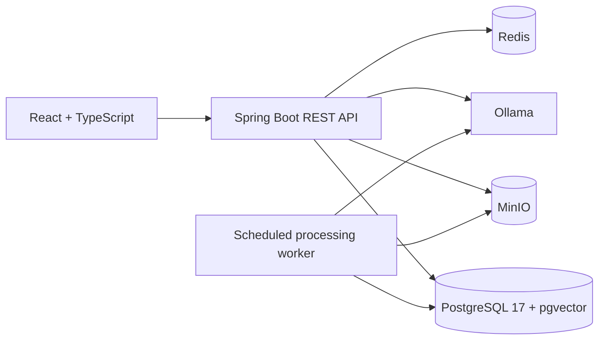

# InferaDocs

**Secure, multi-tenant AI document intelligence — Java 21, Spring Boot, React, PostgreSQL/pgvector, Redis, MinIO and Ollama.**

[](https://github.com/Akasherf/InferaDocs/actions/workflows/ci.yml)


InferaDocs lets teams upload documents, search across them with keyword or vector retrieval, ask questions with source-linked answers, and administer organization-scoped knowledge workspaces. It is a **modular monolith**, built as a Java backend plus a React frontend; the AI models run locally through Ollama.

> **Project status:** Core portfolio features implemented and local builds/tests completed. The GitHub Actions pipeline validates code quality, tests, frontend build, Compose configuration and secrets/IaC checks. This is **not** a production security certification or a hosted SaaS demo.

## Features

| Area | Implemented functionality |
| --- | --- |
| Document lifecycle | Upload, list, download and soft-delete PDF, DOCX and TXT files (20 MB system cap) |
| Processing pipeline | Durable PostgreSQL job records, asynchronous indexing/embedding, status polling, retry and error reporting |
| Search | PostgreSQL full-text, pgvector semantic search, hybrid retrieval and optional reranking |
| Cited AI answers | Ollama-based retrieval-augmented generation with references to authorized document chunks |
| Context-aware chat | Persistent workspace-scoped conversations, messages and bounded follow-up context |
| Identity & tenancy | JWT access tokens, rotating refresh sessions, organizations, membership roles and authorization checks |
| Workspace settings | Upload limits, manual retention preview/soft-delete, AI model and retrieval preferences |
| Administration | Organization-scoped document, chunk, conversation, membership, job and audit-event views |
| Developer experience | Flyway schema migrations, Maven/JUnit/Testcontainers tests, frontend lint/build and GitHub Actions CI |

### Architecture at a glance



**[View detailed architecture and data-flow diagrams](docs/architecture.md)** — includes the processing pipeline, retrieval/citation path and security boundaries.

## Tech stack

- **Backend:** Java 21, Spring Boot 4.0.0, Spring Security, REST APIs, Spring Data JPA/JDBC, Flyway, Maven.
- **Frontend:** React 18, TypeScript, Vite, Tailwind CSS, Axios.
- **Data:** PostgreSQL 17, pgvector, Redis, MinIO (S3-compatible object storage).
- **AI:** Ollama; default answering model `llama3.1:8b` and embedding model `nomic-embed-text` (768 dimensions).
- **Testing/CI:** JUnit, Mockito, Testcontainers, ESLint, TypeScript, GitHub Actions, Checkstyle, SpotBugs and Trivy secrets/IaC scan.

## Run locally

### Prerequisites

- Java 21 and Maven (or the included `backend/mvnw`)
- Node.js 22+ and npm
- Docker Engine/Desktop with Docker Compose
- Ollama installed and running locally, with sufficient memory/disk for the selected models

### 1. Clone and configure

```bash
git clone https://github.com/Akasherf/InferaDocs.git
cd InferaDocs
cp .env.example .env
```

Edit `.env` before starting services. Its included credentials are **development examples**, not deployment secrets. Keep `.env` out of Git. If you change the PostgreSQL host port, also change `SPRING_DATASOURCE_URL`.

### 2. Start the data services

```bash
docker compose --env-file .env -f infrastructure/docker-compose.yml up -d
docker compose --env-file .env -f infrastructure/docker-compose.yml ps
```

By default, these services bind to localhost:

| Service | Address |
| --- | --- |
| PostgreSQL / pgvector | `127.0.0.1:5434` |
| Redis | `127.0.0.1:6380` |
| MinIO API / console | `127.0.0.1:9000` / `127.0.0.1:9001` |

Container volumes persist across restarts. **Do not run `docker compose down -v`** if you want to keep documents and database records. Changing `POSTGRES_PASSWORD` after the volume is initialized does not automatically rotate the database user's password.

### 3. Prepare local AI models

```bash
ollama pull nomic-embed-text
ollama pull llama3.1:8b
```

Start Ollama if it is not already running (for example, launch the Ollama app, or use `ollama serve` in a separate terminal). By default the backend calls `http://localhost:11434`. AI-related requests need Ollama; authentication, document metadata and basic full-text search do not require an answer model.

### 4. Start the backend

In a terminal at the repository root, export the trusted local `.env` variables so Spring Boot sees the same database/storage credentials as Docker Compose:

```bash
set -a
source .env
set +a
cd backend
./mvnw spring-boot:run
```

Backend: `http://localhost:8081/api/v1`

Verify:

```bash
curl http://localhost:8081/api/v1/actuator/health
```

The backend runs Flyway migrations on startup. The repository contains migrations **V1–V10**.

### 5. Start the frontend

Open another terminal:

```bash
cd InferaDocs/frontend
npm ci
npm run dev
```

If you are already at the repository root, use `cd frontend` instead. Open **http://localhost:5173**. Register or sign in, select/create an organization, upload a document, then process it from the Documents page.

> **Environment caveat:** Docker Compose reads the root `.env` only because `--env-file .env` is supplied above; Spring Boot reads exported environment variables. The frontend uses `VITE_API_BASE_URL` at build time (default: `http://localhost:8081/api/v1`). If you customize frontend configuration, supply its Vite variables to that process as well.

## Typical workflow

1. Create an organization and upload a PDF, DOCX or TXT file.
2. Start processing and follow its queued/indexing/embedding/completed status.
3. Search with **Keyword**, **Semantic** or **Hybrid** mode.
4. Ask a question in the AI Assistant and inspect its citations.
5. Ask follow-up questions in the saved conversation.
6. Review workspace statistics, model preferences or retention settings as an authorized administrator.

The RAG system can decline to answer when indexed evidence is insufficient. Search quality depends on document content, extracted text, model availability and query wording.

## Selected API routes

All paths below have the `/api/v1` prefix.

| Method | Path | Purpose |
| --- | --- | --- |
| `POST` | `/auth/register`, `/auth/login` | Identity |
| `GET` | `/auth/me` | Current user |
| `GET` | `/organizations` | Accessible workspaces |
| `POST` / `GET` | `/organizations/{orgId}/documents` | Upload / list documents |
| `POST` | `/organizations/{orgId}/documents/{docId}/processing` | Enqueue processing |
| `GET` | `/organizations/{orgId}/documents/{docId}/processing` | Processing status history |
| `GET` | `/organizations/{orgId}/search` | Keyword search |
| `GET` | `/organizations/{orgId}/semantic-search` | Semantic search |
| `GET` | `/organizations/{orgId}/hybrid-search` | Hybrid search |
| `POST` | `/organizations/{orgId}/ai/ask` | Cited answer |
| `GET` | `/organizations/{orgId}/ai/conversations` | Conversation history |
| `GET` / `PUT` | `/organizations/{orgId}/preferences` | Workspace preferences |
| `GET` | `/organizations/{orgId}/admin/overview` | Admin counters and recent audit events |

Protected endpoints require an authenticated user with access to the organization. See the controllers under `backend/src/main/java/com/documind` for the full request/response contracts.

## Quality checks

```bash
# Backend unit + integration lifecycle (Docker required for Testcontainers)
cd backend
./mvnw clean verify -Ptest

# Frontend checks
cd ../frontend
npm ci
npm run lint
npm run build

# Compose validation (from repository root)
cd ..
docker compose --env-file .env -f infrastructure/docker-compose.yml config --quiet
```

[GitHub Actions](https://github.com/Akasherf/InferaDocs/actions) runs backend tests and quality checks, frontend lint/type-check/build, Compose validation and Trivy **secrets/infrastructure misconfiguration** scanning. Trivy's offline configuration avoids remote Maven resolution; this is not equivalent to a complete software-composition/dependency vulnerability audit.

## Repository layout

```text
InferaDocs/
├── .github/workflows/ci.yml
├── backend/
│   ├── src/main/java/com/documind/
│   │   ├── identity/         # Authentication and sessions
│   │   ├── organization/     # Workspaces and members
│   │   ├── document/         # Upload and lifecycle
│   │   ├── processing/       # Async job worker
│   │   ├── search/           # Text, embeddings, retrieval
│   │   ├── rag/              # Grounded answers, conversations
│   │   ├── workspace/        # Preferences, admin and retention
│   │   └── audit/            # Audit events
│   ├── src/main/resources/db/migration/  # V1–V10
│   └── src/test/
├── frontend/src/
│   ├── pages/
│   ├── components/
│   ├── context/
│   └── services/
├── infrastructure/docker-compose.yml
├── docs/architecture.md
└── .env.example
```

## Security scope and limitations

- Development defaults in `.env.example`, `application.yml` and Compose must be replaced or hardened for external deployment. Do not commit private keys, JWTs, production credentials or uploaded documents.
- The internal namespace `com.documind`, database name `documind`, and existing JWT identifiers are retained intentionally; **InferaDocs** is the product brand.
- Organization authorization and role checks are implemented, but this repository has not been independently penetration-tested.
- Retention cleanup is **manual soft deletion**, not permanent erasure from MinIO. A separate purge/backup policy is necessary for compliance-sensitive deployments.
- The default Ollama model runs locally; inference speed depends on the host hardware.
- Passing CI verifies the configured checks; it does not certify production readiness.

## License

No open-source license is currently included in the repository. All rights are reserved unless a license is added.
