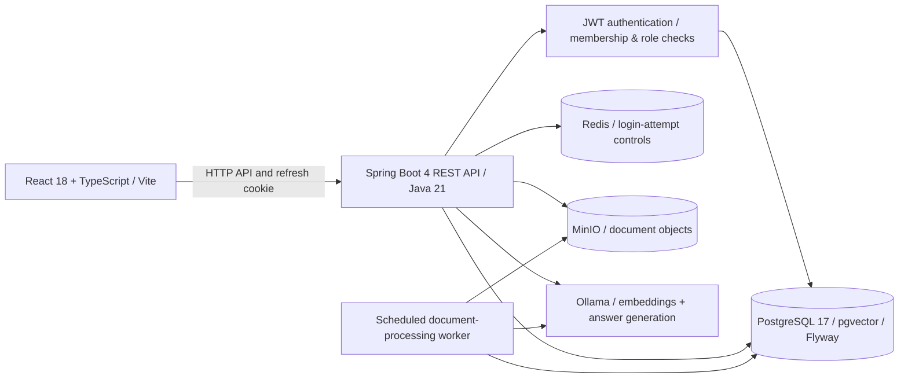
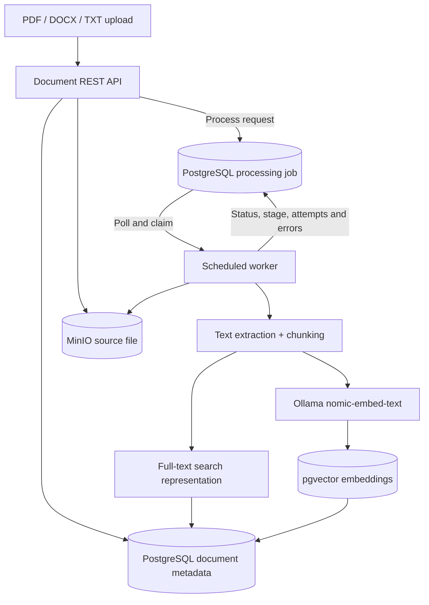
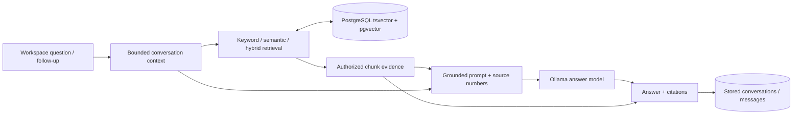
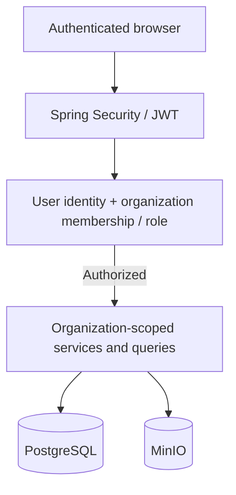

# InferaDocs architecture

This document describes the architecture implemented in the [InferaDocs repository](https://github.com/Akasherf/InferaDocs). It is a **modular Spring Boot monolith**, not a microservice deployment. The public product name is InferaDocs; existing package names (`com.documind`), database identifiers and API paths remain unchanged.

## System overview

The frontend is a separate development server. The backend provides authentication, workspace-scoped APIs, document management, search, conversation history, and administrative operations. PostgreSQL holds relational metadata, chunks, vectors, conversation records and processing jobs; MinIO holds uploaded source files. Redis supports security-related state such as login-attempt controls.

## Document ingestion and processing

- Documents can be processed from the Documents page or its processing API.
- A scheduled worker claims queued jobs, indexes extracted text, generates embeddings, and records completion or failure.
- Job status is persistent; the UI polls the processing API. There is **no fabricated percentage-complete metric**.
- The embedding service expects **768 dimensions**, using `nomic-embed-text` by default. An incompatible embedding model cannot simply be swapped in without a schema and index migration.
- Reprocessing is designed to reuse already indexed chunks when only embeddings are missing.

## Search and cited AI answers

- Keyword search uses PostgreSQL full-text search. Semantic search uses embeddings; hybrid search combines retrieval signals with optional reranking.
- Search and RAG are scoped by organization and authorized user access.
- Answers cite server-supplied document/chunk references. AI responses are not independent proof of factual accuracy; users should inspect cited excerpts.
- Conversation records persist in PostgreSQL. Follow-up context is bounded to avoid unbounded prompts.
- The default local answer model is `llama3.1:8b` and the embedding model is `nomic-embed-text`. Workspace settings allow changing the answer model, temperature, evidence count and optional reranking.

## Security and tenancy boundaries

- JWT access tokens and refresh-session rotation protect authentication. Keep signing keys private; the development-time generated keys are not suitable for production.
- Organizations support the OWNER, ADMIN, MEMBER and VIEWER role model, with per-operation authorization enforced by application services.
- Workspace preferences and administration counters are organization-scoped.
- Retention applies **manual soft deletion** to eligible documents. It does **not** physically erase MinIO objects and is not a compliance-grade data-erasure facility.
- Docker Compose is configured for **localhost development**. Do not treat this as an internet-facing deployment specification.

## Runtime map

| Component | Development address | Function |
| --- | --- | --- |
| React/Vite | `http://localhost:5173` | Web interface |
| Spring Boot | `http://localhost:8081/api/v1` | REST API |
| PostgreSQL/pgvector | `127.0.0.1:5434` | Data, full-text search, vectors, jobs |
| Redis | `127.0.0.1:6380` | Security-related in-memory state |
| MinIO API / console | `127.0.0.1:9000` / `127.0.0.1:9001` | Object storage |
| Ollama | `http://localhost:11434` | Embedding and answer models |

Port settings are configurable. The root `.env` is not automatically imported into every process: pass it to Docker Compose with `--env-file` and export it for the backend process if you override defaults.

## Source layout

- `backend/src/main/java/com/documind/identity` — authentication and sessions
- `backend/src/main/java/com/documind/organization` — workspaces and membership
- `backend/src/main/java/com/documind/document` — upload and document lifecycle
- `backend/src/main/java/com/documind/processing` — queued processing and worker
- `backend/src/main/java/com/documind/search` — extraction, chunking, full-text/vector search
- `backend/src/main/java/com/documind/rag` — cited RAG and conversation history
- `backend/src/main/java/com/documind/workspace` — preferences, administration, retention
- `backend/src/main/java/com/documind/audit` — audit records
- `backend/src/main/resources/db/migration` — Flyway V1–V10
- `frontend/src/pages` — user-facing pages
- `infrastructure/docker-compose.yml` — local service stack

## Verification and limitations

GitHub Actions covers backend tests, backend quality checks, frontend lint/type-check/build, Docker Compose validation, and Trivy **secrets/IaC** checks. The Trivy job runs in offline mode to avoid Maven Central rate limits; it is **not** a full dependency-CVE audit. See the [CI runs](https://github.com/Akasherf/InferaDocs/actions).

This is a locally validated portfolio implementation. Public deployment, production key management, hardening, backups/restore testing, full data purging, load testing, and comprehensive security assessment are outside the verified scope.
